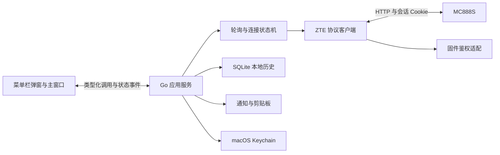

# ZTEMate 开发方案研究

> 历史设计草案。功能与验证状态以 README 和 verification.md 为准。

研究日期：2026-11-09。本文是开发建议，不是设备兼容性或性能测试报告。

## 1. 结论与证据边界

建议采用 MyGo + Go + Vue 3/TypeScript，开发单台 MC888S 的 macOS 菜单栏监控与短信工具。先验证固件协议，再开发桌面界面。第一版不替代完整的路由器后台。

仓库现状：只有 Apache-2.0 LICENSE，远端为 feiyushaw/ztemate。保留现有项目名称和许可证。附件 chat.md 是需求与方案线索，其中的“已实测”“完全适配”“最优”“18 MB”不能作为本项目验证证据。截图支持识别 MC888S 和原厂界面的功能，不能证明具体 API、信号字段含义或会话策略。

### 公开资料核查

| 事项 | 资料结论 | 本项目状态 |
| --- | --- | --- |
| MyGo 桌面能力 | 官方支持系统 WebView、托盘、菜单栏文字和窗口生命周期控制 | 文档核查；未运行验证 |
| MyGo 工具链 | 当前入门文档要求 Go 1.27+，Web 前端使用 Bun/Vite | 初始化时锁定经过构建验证的版本 |
| GoForm 登录 | 社区实现使用 LD 与大写 SHA-256 摘要 | MC888S 当前固件未验证 |
| AD 参数 | MC889 示例采用 SHA256_UPPER(RD)，其他实现使用版本字段参与计算 | 不存在已确认的全型号通用公式 |
| 短信 | zte-sms 作者报告实测 MC7010 | 不外推为 MC888S 实测支持 |
| 内存和体积 | 附件没有可复现测量记录 | 未验证；不写入宣传承诺 |

来源见文末。社区仓库是作者实现的一手资料，不是中兴官方协议保证。

## 2. 产品范围

### v0.1：单机闭环

- 自定义路由器地址、连接检查、密码登录、会话失效提示。
- 菜单栏状态、连接制式、上下行速率、最近更新时间。
- 总览中的 LTE/NR 信号指标，缺失字段显示“设备未提供”。
- 短信分页同步、本地历史、号码会话、验证码候选、一键复制。
- 本地通知；默认隐藏验证码和短信正文。
- 接入设备列表，仅展示固件实际提供的字段。
- 手动配置套餐额度与账期，明确标注统计来源。

### 后续版本

- v0.2：在实机写操作验证后增加短信发送、标记已读、手动清理。
- v0.3：补充经过验证的其他固件适配，增加导出和发布自动化。
- 暂不承诺：按设备统计流量或限速、锁频、自动断网、自动删短信。

全路由器吞吐率不等于 Mac 或 Ubuntu 各自的吞吐率。获取每台设备数据必须另行验证固件接口。套餐余量不等于运营商账单余量。截图中的“-78 dBm”不直接标为 NR RSRP，也不直接判定“极佳”。

## 3. 技术结构



前端只调用明确的 Go 服务方法，不直接请求路由器。协议客户端不依赖 MyGo 或 SQLite。默认只连接一台设备。菜单栏和主窗口共享后台状态，不各自创建轮询器。

建议接口：Connect、Disconnect、GetSnapshot、ListMessages、CopyCode；后续增加 SendMessage 和 MarkRead。状态快照包含采集时间、来源、有效性和错误类型。前端重开时先取完整快照，再订阅变化。前端中的短信作为纯文本渲染。

建议使用单一 Go module。初期客户端放 internal/zte，协议稳定后再公开 zte 包；避免过早承诺公共 SDK 的兼容性。暂不拆成多个仓库或多个 Go module。

建议目录：

```text
main.go                  MyGo 桌面入口
mygo.config.ts           应用标识与打包配置
cmd/ztemate-cli/          独立协议验证工具
internal/zte/            请求、鉴权适配、短信、字段归一化
internal/app/            服务方法与共享状态
internal/poller/         连接状态机与任务调度
internal/store/          SQLite 与迁移
internal/platform/       Keychain、通知、剪贴板
src/                     Vue 界面，遵循锁定版本的官方模板
resources/               图标
docs/                    开发方案、协议证据、兼容矩阵
```

SQLite 驱动在最小打包实验后确定。纯 Go 驱动不代表 MyGo 整体无需原生编译链。优先使用 MyGo 的系统能力；有缺口时才补充平台桥接。

## 4. 实机协议验证是第一道关卡

1. 确认设备地址、型号、运营商版本和完整固件版本。
2. 用浏览器网络面板观察一次正常登录和状态读取。
3. 观察短信列表、翻页、读取状态的真实请求。
4. 对照管理页 JavaScript，记录摘要大小写与参数编码。
5. 用独立 CLI 重现登录和只读调用。
6. 单独验证发送、已读、删除；记录请求与实际结果。

证据包含接口、请求方法、字段、固件版本、预期结果和复核日期。捕获文件保留在仓库之外；提交的样本必须脱敏。不得根据型号自动试遍多个密码算法。密码错误停止重试。若当前固件触发登录互斥，提供暂停监控入口，停止与浏览器反复争抢会话。

路由器管理地址由使用者填写，不设统一默认地址。配置时展示实际目标地址，避免接错设备。不得从本地路径推断 Ubuntu 或其他设备的数据可用性。

### 鉴权与错误恢复

状态：未配置 → 连接中 → 在线；异常分为网络不可达、鉴权过期、密码错误、协议不兼容、用户暂停。

- 同一时刻最多一次登录；并发请求共享登录结果。
- 只读请求在重新鉴权后最多重试一次。
- 发送短信超时显示“发送结果未确认”，不得自动重复发送。
- 网络错误采用有上限的退避；密码错误要求用户修正。
- 不支持字段返回缺失值，不用 0 伪装有效读数。
- HTTP 200 仍检查业务错误、空内容和登录页面响应。

## 5. 轮询与数据正确性

以下是初始调度建议，必须以实机延迟和错误率调整：

| 场景 | 速率与信号 | 短信变化检查 | 接入设备 |
| --- | --- | --- | --- |
| 窗口可见 | 2 秒 | 5 秒 | 30 秒 |
| 后台 | 30 秒 | 10 秒 | 暂停 |
| 短信窗口可见 | 2 秒 | 3–5 秒 | 暂停 |
| 系统睡眠 | 暂停 | 暂停 | 暂停 |

同一类请求不得叠加；慢请求结束后再排下一次。唤醒后立即同步一次，不补跑睡眠期间的任务。后台组合查询约 8,640 次/日；若信号单独查询，则额外约 2,880 次/日。这是调度预算，不是功耗测量。附件的 5 秒轮询为 17,280 次/日。

不得只依赖未读数量变化发现新短信。用户在网页读过短信后，未读数可以不变。增加定期增量对账，并验证分页是否稳定。通知只针对首次同步完成后发现的新记录，历史导入不批量通知。

数据模型建议：

- RouterProfile：本地 UUID、地址、型号、固件、能力、Keychain 引用。SQLite 不存密码。
- Message：本地 UUID、设备 UUID、远端 ID、号码、设备时间、同步时间、正文、方向、远端状态。远端 ID 不直接作全局主键。
- MessageIdentity：设备 UUID、远端 ID、时间、正文摘要，保留 ID 复用判别依据。无法区分的相同内容不得静默删除。
- Outbox：本地发送 ID、号码、正文、提交时间、结果状态、远端引用。超时结果保留为未确认。
- UsageCycle：账期、用户额度、来源、计数器基线与重置记录。计数器归零不产生负流量。

数据库事务提交是本地归档完成点。远端短信与本地历史分别保留状态。远端删除不会同步删除本地历史。先归档、复核远端 ID 后才允许用户删除远端短信。第一版不自动清理。

短信解码根据固件确认的编码选择 UTF-16BE、GSM 7-bit 或其他形式。奇数字节和非法 Hex 必须返回错误。附件示例在 Hex 有效但字节数为奇数时会返回 nil 错误，不能直接复用。UTF-16 代理对与严格 UCS-2 的区别必须测试。长短信优先依靠分段引用号、序号和总段数重组；缺少这些字段时保留原记录，不按相近时间强行拼接。

## 6. 界面设计

建议菜单栏弹窗约 360 × 480，主窗口约 960 × 680，均为设计起点。只做一套视觉体系：系统字体、中性背景、蓝色强调、少量状态色、深浅色适配。图表颜色与单位固定。

菜单栏弹窗从上到下展示：

1. 设备别名、在线状态、最后同步时间。
2. 上下行速率与最近 60 秒曲线。
3. 最新验证码卡片和“复制”按钮。
4. 套餐估算、未读数量、打开主窗口。

主窗口使用“总览 / 短信 / 设备 / 设置”四个侧边栏入口。总览优先展示信号、速率和连接状态。短信使用号码列表与消息详情双栏。设置集中放置地址、凭据、通知、账期和隐私选项。

断线时保留历史数据并标记“数据过期”。无权限与固件不支持分别说明。验证码复制与标记已读分成两个动作。自动覆盖剪贴板默认关闭。IMEI、IMSI、ICCID 默认隐藏，截图和导出默认脱敏。

## 7. 开源与发布

- 保留 Apache-2.0；README 不宣称“全型号支持”或未经测量的资源占用。
- 兼容矩阵按“型号 + 固件 + 功能”登记，附复核日期。
- 添加设备适配 Issue 模板、贡献指南和脱敏要求。
- CI 检查 Go 单测、前端类型和构建；真实路由器测试独立运行。
- 使用固定依赖版本和锁文件，不在发布时自动追随 latest。
- 在 macOS 上构建和验证目标架构；首版优先 Apple Silicon，Intel 后续独立验证。
- 发布前验证 .app、签名、公证和干净用户环境安装。仅生成 DMG 不等于完成分发验证。
- 记录整个应用进程组的内存、空闲 CPU、唤醒次数和请求数量；不能只测 Go 主进程。

## 8. 开发顺序与验收

| 阶段 | 交付物 | 通过条件 |
| --- | --- | --- |
| P0 协议取证 | CLI、脱敏样本、固件记录 | 实机登录与状态/短信列表对齐网页 |
| P1 桌面实验 | 最小 .app、菜单栏弹窗 | 关窗口后后台继续；通知、复制、睡眠恢复正常 |
| P2 产品闭环 | 总览、短信归档、设置 | 重启无重复通知；分页不漏；断线显示过期 |
| P3 写操作 | 发送、已读、手动清理 | 中文/长短信验证；发送超时不自动重发 |
| P4 开源发布 | 文档、兼容矩阵、安装包 | 干净环境安装；脱敏复核；签名状态明确 |

测试重点：鉴权并发、会话过期、短信编码、远端 ID 复用、分页变动、账期切换、计数器重置、发送超时、睡眠恢复、关闭全部窗口。协议单测使用模拟 HTTP 服务，实机测试只作用于用户授权的测试短信与设备。

个人开发排期建议：P0/P1 预留 3–5 个工作日，P2 预留 5–8 日，P3/P4 预留 4–7 日。该估算假设设备、密码和开发证书条件齐备，不是交付承诺。P0 不通过时重估，不先扩充前端功能。

## 9. 待确认与验证状态

未确认：设备实际地址、完整固件版本、Mac 架构与最低系统版本、是否具备签名公证条件。后续由设备配置与构建实验确认。

未验证：本次未登录路由器，未执行 API、MyGo 构建、通知或性能测试。研究只包含附件、仓库现状和公开资料核查。本次未创建远端仓库、推送提交或修改设备。

## 10. 参考资料

- [MyGo 项目](https://github.com/egoist/mygo)：框架与系统 WebView 能力。
- [MyGo 入门](https://mygo.egoist.dev/docs/getting-started)：当前工具链、模板和构建入口。
- [MyGo 菜单与托盘](https://mygo.egoist.dev/docs/menus)：文字状态、关闭窗口后的生命周期。
- [MyGo 构建与分发](https://mygo.egoist.dev/docs/distribution)：应用打包与分发路径。
- [zte-sms](https://github.com/lhotari/zte-sms)：MC7010 的短信实现与作者报告的测试范围。
- [zte-mc889-api](https://github.com/bernhardberger/zte-mc889-api#auth-flow)：特定 MC889 固件的鉴权流程，说明 AD 算法差异。
